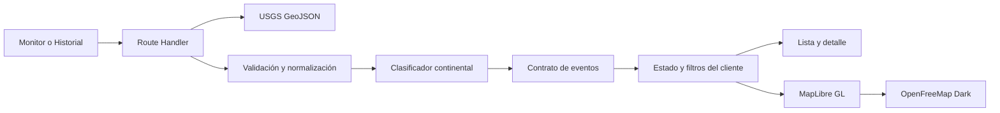

# Plan de implementación — Monitor sísmico

## Estado

Aprobado por el usuario el 2026-10-20. La especificación también está aprobada.

## Alcance técnico

Implementar la primera integración real de QuakeSignal con los feeds GeoJSON públicos de USGS, mantener el mapa y la lista sincronizados y completar la consulta manual de Historial. Se conserva la aplicación Next.js existente; no se agrega un servidor, una base propia ni autenticación.

## Arquitectura y flujo de datos

1. El cliente solicita /api/v1/events?period=hour|day|week.
2. El Route Handler selecciona el feed resumen oficial de USGS correspondiente, lo consulta sin caché y valida su estructura y metadatos.
3. Un adaptador convierte cada feature válido a un modelo interno estable. Omite eventos sin ID o tiempo de origen válido; conserva valores ausentes como null y trata coordenadas inválidas como ausentes.
4. Un clasificador geográfico asigna continente solo si el epicentro cae dentro de una geometría continental disponible. Coordenadas oceánicas o fuera de las geometrías quedan sin continente.
5. Monitor y Historial consumen el mismo contrato. El cliente filtra, calcula conteo y magnitud máxima, ordena eventos, conserva la última respuesta válida y sincroniza selección, lista, detalle y mapa.
6. El mapa se monta únicamente en el navegador. Un límite de error propio permite que el feed siga funcionando si falla el servicio cartográfico.

## Decisiones técnicas

- **Fuente:** mapear hora, día y semana a los feeds oficiales all_hour.geojson, all_day.geojson y all_week.geojson. El endpoint mantiene Cache-Control: no-store; el generated del feed se distingue de la hora local de recepción y de las horas de origen de los eventos. La consulta cada 60 segundos pertenece al cliente de Monitor, no a Historial.
- **Contrato interno:** representar explícitamente ID, magnitud nullable, lugar nullable, coordenadas nullable, profundidad nullable, origen UTC, actualización, alerta, enlace oficial y continente nullable. Separar el adaptador externo de los componentes para que los campos de USGS no se propaguen por toda la UI.
- **Clasificación continental:** incorporar una versión generalizada de Natural Earth 1:110m con su propiedad de continente y su atribución/procedencia en el repositorio. Resolver el punto contra polígonos en el servidor y mapear las etiquetas del dataset a las opciones del producto. El dataset es de dominio público; su generalización reduce tamaño y precisión de costa, un límite aceptado para filtros continentales, no para mostrar coordenadas del epicentro.
- **Mapa:** agregar MapLibre GL como dependencia y cargarlo solo desde un componente cliente. Antes de crear el mapa, configurar su worker con setWorkerUrl y la URL de maplibre-gl-worker.mjs resuelta mediante import.meta.url, siguiendo la integración oficial para Next.js 15+ y Turbopack. Usar el estilo Dark público de OpenFreeMap; mantener atribución del estilo visible y el origen USGS visible fuera del mapa. Centralizar la URL del estilo para poder cambiar el proveedor. La instancia pública de mapas no ofrece SLA.
- **Marcadores:** mantener los intervalos exactos de magnitud en una única definición compartida por leyenda y estilo del mapa. Los eventos sin magnitud usan estilo neutral. La fuente GeoJSON del mapa activa agrupación por zoom; seleccionar un grupo ajusta la cámara a su extensión.
- **Estado del cliente:** guardar cada conjunto recibido junto a período y hora de recepción. Las consultas llevan una clave o secuencia para descartar respuestas antiguas. Durante una actualización se conserva el conjunto completo visible. Si un cambio de período falla, se restaura el último período cargado correctamente; los filtros se aplican al conjunto correspondiente sin mezclar resultados.
- **Errores:** distinguir error de fuente, feed válido vacío, cero resultados por filtros y error cartográfico. No crear datos de reserva ni reemplazar los datos sísmicos cuando falle el mapa.
- **Fechas y unidades:** presentar origen y actualización en la zona local del visitante con zona horaria explícita y equivalente UTC, profundidad en kilómetros y la hora de generación del feed con etiquetas distintas.

## Áreas del repositorio

| Área | Cambio previsto | Motivo |
| --- | --- | --- |
| src/features/events/lib/ | Tipos internos, parser/normalizador USGS, selección de feed, filtros, resumen y clasificación | Aislar reglas de datos y mantener los cálculos consistentes |
| src/features/events/data/ | Geometrías continentales generalizadas y nota de procedencia | Clasificar por coordenadas sin depender del texto de lugar |
| src/app/api/v1/events/route.ts | Validar período, consultar fuente, normalizar y responder con errores recuperables | Sustituir el 503 provisional actual |
| src/features/events/hooks/ | Carga del cliente, sondeo visible, actualización, retención de resultados y protección ante respuestas antiguas | Cubrir el ciclo de vida de Monitor y la carga manual de Historial |
| src/features/events/components/ | Filtros, feed accesible, detalle y mapa aislado | Implementar la experiencia sincronizada |
| src/components/app-shell/app-shell.tsx | Mostrar estado/frescura de USGS y conectar la acción de actualización de la página activa | Completar la barra superior descrita en DESIGN.md y FR-009 |
| src/app/page.tsx, src/app/history/page.tsx | Conectar Monitor e Historial a la experiencia de eventos | Reemplazar los estados de fuente pendiente |
| src/app/globals.css | Diseño responsive, foco, tamaños táctiles y estilos del mapa/estados | Mantener la dirección de DESIGN.md |
| package.json, package-lock.json | Incorporar MapLibre GL | Render cartográfico en navegador |

Los nombres de módulos son una propuesta de planificación; se ajustarán solo si la estructura actual exige una ubicación equivalente, sin cambiar requisitos.

## Riesgos y casos límite

- USGS o OpenFreeMap pueden no responder. Se conservan resultados válidos cuando los haya y se ofrece reintento en la región correspondiente.
- La instancia pública de mapas no tiene SLA. La URL queda centralizada y la lista no depende del mapa.
- Una geometría continental generalizada puede no cubrir puntos costeros con la misma precisión que un dataset de alta resolución. La coordenada de origen se conserva tal como la reporta USGS; un punto sin continente solo queda fuera de filtros continentales.
- Magnitudes, alertas, profundidad, ubicación y enlaces pueden faltar. Se presentan como no disponibles o se omiten según la especificación; no se imputan.
- Respuestas solapadas por cambio de período o regreso de una pestaña en segundo plano no deben sustituir una selección más reciente.
- Un feed vacío válido se distingue de una estructura inválida o de una respuesta donde todos los eventos se descartaron.
- La clasificación en bordes compartidos debe ser determinista y usar el orden estable del dataset.
- La lista debe seguir operable si WebGL, el estilo o los mosaicos fallan.

## Verificación prevista

No hay un script de pruebas configurado en el proyecto al momento de planificar. Al completar la implementación se comprobarán las verificaciones existentes (npm run lint y npm run build) y se recorrerán los criterios AC-01 a AC-10 con feeds de hora, día y semana, estados de error/vacío, filtros combinados, selección, teclado, mapa fallido y vista móvil. Para estados no reproducibles desde USGS se usarán respuestas fixture/mock locales de feed válido vacío, parcialmente inválido, completamente inválido y error de red. Los resultados se reportarán por separado; una compilación correcta no se presentará como prueba de cada interacción.

## Referencias

- [USGS GeoJSON Summary Format](https://earthquake.usgs.gov/earthquakes/feed/v1.0/geojson.php)
- [MapLibre GL JS](https://maplibre.org/maplibre-gl-js/docs/)
- [OpenFreeMap](https://openfreemap.org/)
- [Natural Earth 1:110m Cultural Vectors](https://www.naturalearthdata.com/download/downloads/110m-cultural-vectors/)
- [Natural Earth Terms of Use](https://www.naturalearthdata.com/about/terms-of-use/)
